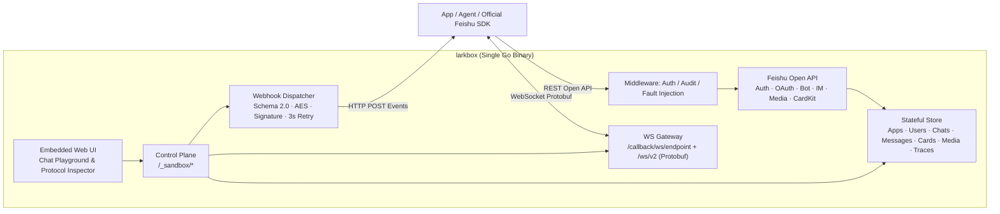

# larkbox

[](https://github.com/littlecrabzzz-alt/larkbox/actions/workflows/ci.yml)
[](LICENSE)
[](https://go.dev/)
[](#roadmap)

**A high-fidelity, protocol-accurate local sandbox and mock server for Feishu / Lark Open Platform — shipped as a single Go binary.**

---

## Table of Contents

- [Goals & Motivation](#goals--motivation)
- [Quick Start](#quick-start)
- [Non-Goals](#non-goals)
- [Deferred / Later Phases](#deferred--later-phases)
- [Core Capabilities](#core-capabilities)
- [Architecture Overview](#architecture-overview)
- [API & Event Compatibility Matrix](#api--event-compatibility-matrix)
- [Verification & Fidelity Strategy](#verification--fidelity-strategy)
- [Roadmap](#roadmap)
- [Documentation & Project Standards](#documentation--project-standards)
- [License](#license)

---

## Goals & Motivation

Teams building Feishu / Lark bots, integrations, and AI agents frequently run into the same testing bottlenecks:

- **Real tenants do not scale for automated testing**: hitting `open.feishu.cn` triggers rate limits, pollutes shared groups, slows feedback loops, and makes edge cases (3-second callback retries, expired tokens, out-of-order streaming updates) hard to reproduce.
- **Ad-hoc mock scripts drift from reality**: hand-rolled mocks usually return `{"code": 0}` unconditionally, omit strict parameter checks, and leave teams unsure whether their integration will actually work against real Feishu.

`larkbox` solves this by providing a **trustworthy, pure-protocol stand-in for Feishu / Lark Open Platform**:

1. **Drop-in compatibility**: Point existing Feishu SDKs (`oapi-sdk-go`, `lark-oapi`, `@larksuiteoapi/node-sdk`) or HTTP clients to `http://127.0.0.1:8080` with zero business code changes.
2. **Protocol accuracy over permissiveness**: Enforce real Feishu validation rules, headers, error codes, encryption/signatures, and wire frames by default (**Strict Mode**).
3. **Verifiable fidelity**: Back every implemented API and event with official SDK integration tests, sanitized golden fixtures, and an opt-in differential live test harness against a real Feishu test tenant.
4. **Zero-friction single binary**: Pure Go (no CGO) with an embedded web chat playground and protocol inspector.

## Quick Start

With Go 1.24 or later, start the local server and check its health.

```sh
go run ./cmd/larkbox
curl -fsS http://127.0.0.1:8080/healthz
```

The server starts in strict mode with a virtual app, bot, users, and chats. The startup log shows the built-in local app credentials. `/healthz` is available in the foundation slice. The compatibility matrix tracks Feishu endpoint implementation.

Configuration precedence is built-in defaults, then the YAML or JSON file passed to `--config`, then environment variables, then explicitly supplied flags (`--addr`, `--strict`). File keys include `addr`, `strict_mode`, `token_ttls` (in seconds), and the `apps`, `users`, and `chats` seed lists. An omitted seed list keeps its defaults. Use `[]` to clear a list. Null seed lists are invalid.

- `LARKBOX_ADDR`, `LARKBOX_STRICT_MODE`
- `LARKBOX_TENANT_TOKEN_TTL`, `LARKBOX_APP_TOKEN_TTL`, `LARKBOX_USER_TOKEN_TTL`, `LARKBOX_REFRESH_TOKEN_TTL`, `LARKBOX_OAUTH_CODE_TTL` (in seconds)
- `LARKBOX_APPS`, `LARKBOX_USERS`, `LARKBOX_CHATS` (JSON arrays)

For local OAuth, supply `app_id` (or `client_id`) and a `redirect_uri` that exactly matches one of the app's configured `redirect_uris`. The demo app registers `http://127.0.0.1:8080/callback` and `http://localhost:8080/callback`. Callbacks must use HTTP or HTTPS and have no fragment. Add `open_id` or `user_id` to select a sandbox user. With neither selector, the server authorizes the first seeded user.

Include the same `redirect_uri` when exchanging a browser code at the v2 token endpoint. Authorization codes and refresh tokens are single-use. OAuth v2 issues a refresh token only when the resulting scope includes `offline_access`.

To receive events over a long connection, point the Go SDK WebSocket client's domain at the larkbox base URL. For HTTP delivery, set `webhook_url` and `verification_token` on the receiving app. Set `encrypt_key` to enable encrypted, signed delivery, and `tenant_key` to set the tenant represented in the event header. With both channels configured, larkbox sends the same event to one active WebSocket session for the app and to the webhook. In-process tests can use `Server.Events().VerifyWebhook` to run URL verification and `server.WithEventOptions` to shorten retry delays. URL verification has a 1-second timeout. Event delivery allows 3 seconds per attempt and up to four retries at 15 seconds, 5 minutes, 1 hour, and 6 hours on either transport. Each app can have up to 50 active long connections by default. [Feishu event handling guide](https://open.feishu.cn/document/uAjLw4CM/ukTMukTMukTM/server-side-sdk/nodejs-sdk/handling-events)

## Non-Goals

- **Pixel-perfect native Feishu rendering**. The planned Web UI focuses on structured card previews, interactive controls, and raw JSON inspection.
- **Production messaging**. The sandbox is designed for local development, debugging, and CI testing.

## Deferred / Later Phases

The core roadmap prioritizes **Auth, IM, Bot, Media, CardKit, and event delivery**. Docs, Bitable, Approval, Calendar, Contacts/HR, and Mail will be evaluated in later phases. The Feishu Open APIs and the `/_sandbox/*` control plane provide modular interfaces for test suites and leave room for future end-to-end testing features.

## Core Capabilities

- **Authentication & Security**: Internal app tokens (`tenant_access_token`, `app_access_token`), user OAuth flows (`authen/v1`, `authen/v2`), strict Bearer token validation & expiration, and full Webhook AES-256-CBC encryption + `X-Lark-Signature` verification.
- **Stateful IM & Bot Engine**: Virtual apps/bots, users, chats (p2p & group), messages, replies/threads, message editing/patching/recall, emoji reactions, and multipart image/file upload & download.
- **CardKit Streaming Cards**: Card entity creation, streaming element updates with monotonic `sequence` enforcement, settings updates, and interactive `card.action.trigger` callbacks.
- **Dual Event Delivery**:
  - **HTTP Webhook (Schema 2.0)** with `url_verification`, optional encryption/signing, and 3-second timeout retry with identical `event_id`.
  - **WebSocket Long Connections** implementing the official SDK Protobuf framing protocol (`/callback/ws/endpoint` + `/ws/v2`).
- **Control Plane & Fault Injection (`/_sandbox/*`)**: Seed state, simulate user messages / `@bot` mentions / card clicks, inspect request & event traces, and inject latency, rate limits (`99991400`), 500s, token expiry, or duplicate event delivery.

## Architecture Overview



See [docs/ARCHITECTURE.md](docs/ARCHITECTURE.md) for detailed design specifications.

## API & Event Compatibility Matrix

Status Legend:
- `Planned` — Scoped for v0.1, not yet implemented
- `Implemented` — Working with strict-mode validation & unit tests
- `SDK-Tested` — Verified end-to-end against official Feishu SDK client
- `Live-Verified` — Verified via differential test against a real Feishu test tenant

### Authentication

| Endpoint | Notes | Status |
|---|---|---|
| `POST /open-apis/auth/v3/tenant_access_token/internal` | App credentials check, TTL, `t-...` token | `SDK-Tested` |
| `POST /open-apis/auth/v3/app_access_token/internal` | Issues `a-...` and `tenant_access_token` | `SDK-Tested` |
| `GET /open-apis/authen/v1/authorize` & `/v1/index` | OAuth redirect with `code` and optional `state` and PKCE | `SDK-Tested` |
| `POST /open-apis/authen/v1/oidc/access_token` | Exchange `code` for `u-...` & `refresh_token` | `SDK-Tested` |
| `POST /open-apis/authen/v1/oidc/refresh_access_token` | Refresh user access token | `SDK-Tested` |
| `POST /open-apis/authen/v2/oauth/token` | JSON or form token exchange and refresh | `SDK-Tested` |
| `GET /open-apis/authen/v1/user_info` | Authenticated user profile (`u-...`) | `SDK-Tested` |

### Bot, IM, Media & CardKit

| Endpoint | Notes | Status |
|---|---|---|
| `GET /open-apis/bot/v3/info` | Current bot profile & `open_id` | `SDK-Tested` |
| `POST / GET /open-apis/im/v1/chats`, `GET /chats/:chat_id` | Create, list, inspect chats | `SDK-Tested` |
| `GET / POST / DELETE /open-apis/im/v1/chats/:chat_id/members` | Manage members and emit bot join and leave events | `SDK-Tested` |
| `POST /open-apis/im/v1/messages` | Strict `receive_id_type` & JSON-string `content` checks | `SDK-Tested` |
| `POST /open-apis/im/v1/messages/:message_id/reply` | Maintains `parent_id`, `root_id`, `thread_id` | `SDK-Tested` |
| `PATCH / PUT / DELETE / GET /open-apis/im/v1/messages/:message_id` | Card update, edit, recall, detail | `SDK-Tested` |
| `GET /open-apis/im/v1/messages` | History list with sort & cursor pagination | `SDK-Tested` |
| `POST / GET / DELETE /open-apis/im/v1/messages/:message_id/reactions` | Emoji reactions | `SDK-Tested` |
| `POST / GET /open-apis/im/v1/images` & `/files` | Multipart upload & binary download | `SDK-Tested` |
| `GET /open-apis/im/v1/messages/:message_id/resources/:file_key` | Download message attachment resources | `SDK-Tested` |
| `POST / PUT / PATCH /open-apis/cardkit/v1/cards*` | Streaming CardKit with monotonic `sequence` check | `Planned` |

### Events & Callbacks

| Event / Transport | Notes | Status |
|---|---|---|
| HTTP Webhook (Schema 2.0) | `url_verification`, AES-256-CBC, `X-Lark-Signature`, 3s retry | `SDK-Tested` |
| WebSocket Long Connection | `/callback/ws/endpoint` + `/ws/v2` Protobuf frames | `SDK-Tested` |
| `im.message.receive_v1` | p2p, group, `@bot` mentions, replies & threads | `SDK-Tested` |
| `im.message.recalled_v1` | Triggered on message recall | `SDK-Tested` |
| `im.chat.member.bot.added_v1` / `deleted_v1` | Bot added/removed from chat | `SDK-Tested` |
| `card.action.trigger` | Interactive button/form callback with toast/card reply | `Planned` |

## Verification & Fidelity Strategy

To prevent mock drift, `larkbox` uses a four-layer verification pyramid:

1. **Unit & State-Machine Tests**: Table-driven Go tests covering strict validation, error codes, crypto, and concurrent state mutations (`go test -race ./...`).
2. **Official SDK Integration Tests**: End-to-end tests running official `github.com/larksuite/oapi-sdk-go/v3` (both REST and `ws.Client`) directly against an in-process `larkbox` server.
3. **Golden Fixtures**: Sanitized request/response/event captures from real Feishu stored in `testdata/fixtures/`.
4. **Live Differential Tests (`//go:build live`)**: Opt-in suite that executes the exact same test assertions against either local `larkbox` or a real Feishu Test Tenant (`FEISHU_LIVE=1`) to catch upstream protocol changes.

## Roadmap

- **Milestone 1 — Core Engine, Auth & IM APIs**: State store, strict-mode protocol layer, Auth/OAuth v1 & v2, Bearer middleware, Bot/Chat/Message/Reaction/Media APIs, official SDK REST integration tests.
- **Milestone 2 — Dual Event Engine & CardKit**: WebSocket Protobuf long-connection gateway, Webhook Schema 2.0 (encryption, signature, 3s retry), CardKit streaming cards, `card.action.trigger`, official `oapi-sdk-go/ws` end-to-end tests.
- **Milestone 3 — Control Plane, Fault Injection & Live Harness**: `/_sandbox/*` control API, request/event trace logs, chaos rules, and `//go:build live` differential test suite.
- **Milestone 4 — Embedded Web Inspector & Chat Playground**: Lightweight React/Vite UI bundled into the Go binary via `//go:embed`.

## Documentation & Project Standards

- [Architecture & Protocol Design](docs/ARCHITECTURE.md)
- [Architecture Decision Records (ADRs)](docs/adr/README.md)
- [Contributing & Engineering Standards](CONTRIBUTING.md)
- [Changelog](CHANGELOG.md)
- [Security Policy](SECURITY.md)
- [Code of Conduct](CODE_OF_CONDUCT.md)

## License

Released under the [MIT License](LICENSE).
