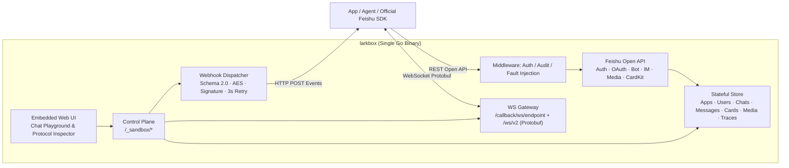

# larkbox

[](https://github.com/littlecrabzzz-alt/larkbox/actions/workflows/ci.yml)
[](LICENSE)
[](https://go.dev/)
[](#roadmap)

**A high-fidelity, protocol-accurate local sandbox and mock server for Feishu / Lark Open Platform — shipped as a single Go binary.**

---

## Table of Contents

- [Goals & Motivation](#goals--motivation)
- [Quick Start](#quick-start)
- [Non-Goals](#non-goals)
- [Deferred / Later Phases](#deferred--later-phases)
- [Core Capabilities](#core-capabilities)
- [Architecture Overview](#architecture-overview)
- [API & Event Compatibility Matrix](#api--event-compatibility-matrix)
- [Verification & Fidelity Strategy](#verification--fidelity-strategy)
- [Roadmap](#roadmap)
- [Documentation & Project Standards](#documentation--project-standards)
- [License](#license)

---

## Goals & Motivation

Teams building Feishu / Lark bots, integrations, and AI agents frequently run into the same testing bottlenecks:

- **Real tenants do not scale for automated testing**: hitting `open.feishu.cn` triggers rate limits, pollutes shared groups, slows feedback loops, and makes edge cases (3-second callback retries, expired tokens, out-of-order streaming updates) hard to reproduce.
- **Ad-hoc mock scripts drift from reality**: hand-rolled mocks usually return `{"code": 0}` unconditionally, omit strict parameter checks, and leave teams unsure whether their integration will actually work against real Feishu.

`larkbox` solves this by providing a **trustworthy, pure-protocol stand-in for Feishu / Lark Open Platform**:

1. **Drop-in compatibility**: Point existing Feishu SDKs (`oapi-sdk-go`, `lark-oapi`, `@larksuiteoapi/node-sdk`) or HTTP clients to `http://127.0.0.1:8080` with zero business code changes.
2. **Protocol accuracy over permissiveness**: Enforce real Feishu validation rules, headers, error codes, encryption/signatures, and wire frames by default (**Strict Mode**).
3. **Verifiable fidelity**: Back every implemented API and event with official SDK integration tests, sanitized golden fixtures, and an opt-in differential live test harness against a real Feishu test tenant.
4. **Zero-friction single binary**: Pure Go (no CGO) with an embedded web chat playground and protocol inspector.

## Quick Start

With Go 1.24 or later, start the local server and check its health.

```sh
go run ./cmd/larkbox
curl -fsS http://127.0.0.1:8080/healthz
```

The server starts in strict mode with a virtual app, bot, users, and chats. The startup log shows the built-in local app credentials. `/healthz` is available in the foundation slice. The compatibility matrix tracks Feishu endpoint implementation.

Configuration precedence is built-in defaults, then the YAML or JSON file passed to `--config`, then environment variables, then explicitly supplied flags (`--addr`, `--strict`). File keys include `addr`, `strict_mode`, `token_ttls` (in seconds), and the `apps`, `users`, `departments`, `chats`, `approval_definitions`, `minutes`, and `card_templates` seed lists. An omitted seed list keeps its defaults. Use `[]` to clear a list. Null seed lists are invalid.

- `LARKBOX_ADDR`, `LARKBOX_STRICT_MODE`
- `LARKBOX_TENANT_TOKEN_TTL`, `LARKBOX_APP_TOKEN_TTL`, `LARKBOX_USER_TOKEN_TTL`, `LARKBOX_REFRESH_TOKEN_TTL`, `LARKBOX_OAUTH_CODE_TTL` (in seconds)
- `LARKBOX_APPS`, `LARKBOX_USERS`, `LARKBOX_CHATS`, `LARKBOX_CARD_TEMPLATES` (JSON arrays)
- `LARKBOX_DEPARTMENTS`, `LARKBOX_APPROVAL_DEFINITIONS`, `LARKBOX_MINUTES` (JSON arrays)

For local OAuth, supply `app_id` (or `client_id`) and a `redirect_uri` that exactly matches one of the app's configured `redirect_uris`. The demo app registers `http://127.0.0.1:8080/callback` and `http://localhost:8080/callback`. Callbacks must use HTTP or HTTPS and have no fragment. Add `open_id` or `user_id` to select a sandbox user. With neither selector, the server authorizes the first seeded user.

Include the same `redirect_uri` when exchanging a browser code at the v2 token endpoint. Authorization codes and refresh tokens are single-use. OAuth v2 issues a refresh token only when the resulting scope includes `offline_access`.

Add the sandbox query parameter `decision=deny` to exercise the OAuth
`error=access_denied` callback and returned `state`. The redirect still has
to be registered. The app can revoke a user or refresh token at
`POST /oauth/v1/revoke`. Inspect current consent with
`GET /_sandbox/apps/{app_id}/grants` and subscribe to the sandbox event
`larkbox.auth.authorization_revoked_v1` to exercise cleanup handlers.

To receive events over a long connection, point the Go SDK WebSocket client's domain at the larkbox base URL. For HTTP delivery, set `webhook_url` and `verification_token` on the receiving app. Set `encrypt_key` to enable encrypted, signed delivery, and `tenant_key` to set the tenant represented in the event header. With both channels configured, larkbox sends ordinary events to one active WebSocket session for the app and to the webhook. In-process tests can use `Server.Events().VerifyWebhook` to run URL verification and `server.WithEventOptions` to shorten retry delays. By default, URL verification has a 1-second timeout. Event delivery allows 3 seconds per attempt and up to four retries at 15 seconds, 5 minutes, 1 hour, and 6 hours on either transport. Each app can have up to 50 active long connections by default. [Feishu event handling guide](https://open.feishu.cn/document/uAjLw4CM/ukTMukTMukTM/server-side-sdk/nodejs-sdk/handling-events)

CardKit writes require the creating app's tenant token. Send or reply with an interactive message whose JSON-encoded `content` is `{"type":"card","data":{"card_id":"..."}}`. The owner sees the latest card in the rendered IM format. Pass `card_msg_content_type=user_card_content` on GET or history to request the underlying card JSON. Other apps in the chat see the stored message reference. Card updates require a positive sequence greater than the previous one. Stale sequences return HTTP 400 and code `300317`. Identical requests can replay a successful UUID for one hour. Reusing it with a different request on the same card and operation returns `200770`. A stream expires after 10 minutes and the entity expires after 14 days. [Feishu CardKit batch update reference](https://open.larkoffice.com/document/cardkit-v1/card/batch_update)

Register local templates through `card_templates`. Each entry has a `template_id`, an optional `template_version_name`, and a `data` string containing a Card JSON 2.0 definition. Without a requested version, larkbox selects the unversioned entry or the last configured version. Registered templates use the local definition and support text streaming on Markdown elements.

In-process tests can call `Server.TriggerCardAction` to simulate an interaction by a chat member. Each action has a three-second deadline and goes to one active WebSocket session, or to the configured webhook if no session is active. By default the callback makes one transport attempt and can return a toast and an updated card. An explicit `duplicate_event` fault sends extra copies with the same event ID. Each copy is a separate delivery attempt, and trace entries identify it with `duplicate_index`.

Use `GET /_sandbox/state` to see the seeded chat and user IDs. Send a user
message with `POST /_sandbox/messages/send`, simulate a card click with
`POST /_sandbox/cards/action`, and inspect deliveries with
`GET /_sandbox/traces`. Use `POST /_sandbox/faults` to add a rule and
`POST /_sandbox/reset` to restore the startup seed. Keep the unauthenticated
control plane on loopback or an isolated test network. See the
[control plane contract](docs/adr/0002-sandbox-control-plane.md) for request
fields, trace filters, and fault options.

### Black-box testing

Use `--addr 127.0.0.1:0 --ready-file /path/to/address` to start a test
instance on a free port. The ready file contains the bound `host:port` and is
written atomically after binding. Give each instance its own file.

```sh
make test-blackbox
```

The [runnable recipe](examples/blackbox.py) uses Python 3 and the built binary.
It starts two isolated servers and a loopback receiver, seeds a webhook,
and asserts matching event IDs after a 503 and a successful retry. It also
checks token and CardKit expiry and sends a real reply after a card callback
deadline to verify that the card is left untouched.

The sandbox CLI uses the same local HTTP contract as other test clients.
Run `larkbox sandbox --help` to list commands and `<command> --help` for flags.
Select a server with `--ready-file` or `--url`. `LARKBOX_URL` supplies the
default URL when neither flag is present. Request bodies can use `--data`
or `--file` (use `--file -` for stdin). The CLI prints the JSON response and
exits nonzero on HTTP errors.

```sh
larkbox sandbox openapi --ready-file /path/to/address
larkbox sandbox state --ready-file /path/to/address
larkbox sandbox traces --ready-file /path/to/address --event-id evt_example
```

Adjust the standalone server's event timing with an `event_delivery` mapping.
Milliseconds are integers. A zero timeout or attempt count uses its Feishu
default. An empty retry list uses the default 15s, 5m, 1h, and 6h delays.
A nonempty list repeats its final delay for additional retries, and a `0`
entry retries immediately.

```yaml
event_delivery:
  webhook_timeout_ms: 500
  verification_timeout_ms: 1000
  ack_timeout_ms: 500
  webhook_max_attempts: 2
  websocket_max_attempts: 2
  retry_backoff_ms: [150]
```

For manual time, set `clock_start` to an RFC3339 timestamp. The clock freezes
at that time until `POST /_sandbox/clock/advance` receives a positive duration
such as `{"by":"15s"}`. `GET /_sandbox/clock` reports the current time and
mode. The same clock controls token and card expiry and the delay after a
failed event attempt. The advance response reports the new time. Due retries
resume asynchronously, so inspect their traces for delivery results.
Network deadlines, webhook signature timestamps, and latency faults use actual time.
A reset cancels pending retries and restores `clock_start` along with the seed.

```sh
larkbox sandbox clock --ready-file /path/to/address
larkbox sandbox advance --ready-file /path/to/address --by 15s
```

An injected message waits for its delivery outcomes. With a manual clock, run
the send in the background and advance time after observing its failed attempt
in traces. `--timeout` overrides the CLI's 30-second request timeout.
Override file settings with `LARKBOX_EVENT_DELIVERY` (a JSON object) and
`LARKBOX_CLOCK_START` (an RFC3339 timestamp). The control plane is intended
for trusted local and test-network clients.

### Official CLI onboarding

Run `make test-cli` with Docker to test application registration, user denial
and approval, recipient search, messaging, content and work workflows, and logout with
official `lark-cli` v1.0.100. The
[CLI test guide](tests/lark_cli/README.md) covers the loopback adapter, browser
confirmation, and scripted device decisions.

### Content and storage

The content APIs store resources under the requesting app or user identity.
Use the returned resource IDs in subsequent calls and supply the matching
OAuth permissions. A new workbook provides `Sheet1` for A1 range reads and
writes. A new Base provides `Table1` with a text field named `Name` for
record creation and keyword search. Drive accepts single-request uploads
up to 20 MiB in the virtual root. Wiki resolves a document node by its
node token or its underlying document token.

### Scheduling and work

Create single events on the requesting identity's primary calendar and
query the agenda by time range. Tasks record creation, edits, completion,
and reopening against the same task GUID.

Seed recorded meetings through `POST /_sandbox/seed` or the `minutes`
configuration list. Each meeting has a lowercase `minute_token`, a title,
an active `owner_open_id` in its tenant, and `duration_ms`. Add `transcript`
and `summary` to exercise `lark-cli minutes +detail` and its file export.

Mail uses the user seed's `enterprise_email` or `email`. The virtual mailbox
accepts MIME drafts, stores a sent copy, and delivers inbox copies to seeded
recipients in the same tenant. Delivery stays inside Larkbox. Search by text
or list the inbox or sent folder, then use the returned message ID to read it.

### Directory and approval fixtures

Assign each user to departments with `department_open_ids`. A tenant token
uses the app's `contact_scope`. A user token uses the signed-in user's
`contact_scope`. Each scope may select department subtrees by
`department_open_ids` and individual contacts by `user_open_ids`. Omit
the scope for full tenant visibility or use `{}` for no additional contacts.
User search in strict mode requires the `contact:user:search` OAuth scope.
The demo users can find each other in the seeded Engineering department.

Seed an approval definition with `approval_code`, `name`, and
`approver_open_id` for a single manual task. An app listening for
`approval_instance` registers the definition through
`POST /open-apis/approval/v4/approvals/{approval_code}/subscribe`. Create an
instance with the applicant's ID and a JSON-encoded `form` array, then read
it to get the task ID. The assigned approver can approve or reject the task,
and the applicant can withdraw a pending instance. After receiving a legacy
approval webhook, the receiver can read the committed state by instance code.
[Feishu approval instance event](https://open.feishu.cn/document/ukTMukTMukTM/uIDO24iM4YjLygjN/event/common-event/approval-instance-event)

### Embedded Web UI

Run `larkbox` (or `go run ./cmd/larkbox` from this repository) and open
[http://127.0.0.1:8080/](http://127.0.0.1:8080/). The inspector lets you
send messages as virtual users, interact with cards, inspect CardKit state
and protocol traces, and manage sandbox fault rules. In the CardKit inspector,
use **Validate card JSON** to check an inline definition and preview it before
sending. The chat preview can submit supported controls and display locally
uploaded raster images. Start with `--no-ui`
to disable the inspector while keeping the HTTP APIs available.

`make build` and `go install github.com/littlecrabzzz-alt/larkbox/cmd/larkbox@latest`
use the committed production assets and require only Go. For frontend
development, install dependencies with `make ui-install`, then run
`pnpm --dir web run dev` alongside larkbox on port 8080. Run `make ui-test`
and `make ui-build` after frontend changes and commit the regenerated
`internal/webui/dist/` with the source.

### Shared test deployments

Run the service in Compose and wait for its container health check.

```sh
docker compose up --build --wait
curl --fail http://127.0.0.1:8080/healthz
```

Compose publishes the HTTP port on loopback. Set `LARKBOX_PORT` to select a
host port, or attach application containers to the Compose network and use
`http://larkbox:8080`. Version tags on `main` publish Linux amd64 and arm64
images to `ghcr.io/littlecrabzzz-alt/larkbox`. On an isolated test network,
set the same operator token in the service and the clients that need its
control plane.

```sh
export LARKBOX_SANDBOX_TOKEN="$(openssl rand -hex 24)"
docker compose up --build --wait
larkbox sandbox state
larkbox sandbox metrics
```

With a token configured, `/_sandbox/` accepts its Bearer credential. Open the
inspector with username `sandbox` and the token as the password. Feishu API
clients continue to authenticate with their usual Feishu-shaped credentials.
For operator access outside the host, use an isolated test network and
terminate HTTPS at your ingress.

Set `LARKBOX_RATE_LIMITS='{"profile":"realistic"}'` to give each app a fixed
window of 50 requests per second and 10,000 successful calls per UTC month.
Supply `qps`, `daily_quota`, or `monthly_quota` for explicit budgets, with
zero disabling that budget. The default profile is `unlimited`. Failed calls
count toward frequency limits. HTTP or Feishu error responses release their
quota reservation. Authenticated Open API calls share their app's budgets.
The manual clock drives the second, day, and month boundaries, and sandbox
reset restores the budgets. A rejection includes HTTP 429, the Feishu error
code, `Retry-After`, and the `X-Ogw-Ratelimit-*` headers.
[Feishu rate limits](https://open.feishu.cn/document/server-docs/api-call-guide/frequency-control) · [Feishu API quota](https://open.feishu.cn/document/uAjLw4CM/ukzMukzMukzM/platform-notices)

Read `GET /_sandbox/metrics` for Prometheus counts of pending asynchronous
deliveries, retry waiters, attempts, failures, retries, and limited calls.
Set `LARKBOX_PPROF=true` with an operator token to enable Go profiles at
`/_sandbox/debug/pprof/`. Set `LARKBOX_JSON_LOGS=true` for metadata-only JSON
logs from the binary. The image enables them by default. The `X-Request-Id`
response header correlates Open API requests with their outbound event
attempts. Use `larkbox sandbox traces --request-id <id>` to inspect them.

The file equivalents are `sandbox_token`, `pprof`, `json_logs`, and
`rate_limits`. The operator token also works with the built-in CLI over the
remote URL provided by `--url` or `LARKBOX_URL`.

### Restart recovery

Set `state_file` or `LARKBOX_STATE_FILE` to a writable file path for a single
instance. Larkbox creates a private checkpoint at startup, replaces it
atomically every second, and writes a final checkpoint on graceful shutdown.
An abrupt restart recovers the last complete write. The persisted state
includes messages and indexes, uploaded bytes, cards and sequences, OAuth
grants and credential deadlines, and content and work resources.

```sh
docker compose -f compose.yaml -f compose.persist.yaml up --build --wait
```

The Compose override retains `/data/state.json` in a named volume when the
container is replaced. A recovered retry keeps its original event ID,
transport, attempt number, and due time. WebSocket retries wait for a peer
to reconnect for up to three minutes. A restored attempt can be delivered
again with the same event ID. Restored manual clocks retain their saved
time. Reset returns to the startup seed and initial clock.

With an operator token, use the versioned snapshot endpoint to move runtime
state between instances using the same clock mode. Snapshot files contain
sandbox credentials and data. Keep them in private storage.

```sh
umask 077
curl --fail --header "Authorization: Bearer ${LARKBOX_SANDBOX_TOKEN}" \
  http://127.0.0.1:8080/_sandbox/snapshot --output snapshot.json
curl --fail --header "Authorization: Bearer ${LARKBOX_SANDBOX_TOKEN}" \
  --header 'Content-Type: application/json' --data-binary @snapshot.json \
  http://127.0.0.1:8080/_sandbox/snapshot
```

Run `make test-restart` to exercise an abrupt process stop and recovery,
followed by an explicit snapshot import and token expiry check.

### Conversation events

Set an app's `event_types` in its config or seed entry to subscribe to a
specific list. An omitted list keeps the default receive, recall, and bot
membership events. An empty list disables ordinary events for that app.
The controls for card callbacks and custom event injection can be used
independently of those subscriptions.

```sh
larkbox sandbox inject-event --data '{"app_id":"cli_larkbox","event_type":"example.custom_v1","event":{"key":"sample"}}'
larkbox sandbox open-chat --data '{"app_id":"cli_larkbox","operator_open_id":"ou_larkbox_bob"}'
```

Subscribe to `p2p_chat_create` and `im.chat.access_event.bot_p2p_chat_entered_v1`
to receive the first conversation event and subsequent entries. The first
event uses the legacy Feishu envelope with a top-level `uuid`.

Configure menus with the app's own tenant token using
`PATCH /open-apis/application/v7/applications/{app_id}/ability`.
Send `bot.enable: true`, `bot.bot_menu_enable`, and the `bot.bot_menus` list
from the Application v7 SDK. Changes take effect immediately in the sandbox.
Read the effective menu at `GET /_sandbox/bots/{app_id}/menu` and click
an event item with `POST /_sandbox/bots/{app_id}/menu/click`. Pass its
`menu_id` and the simulated user's `operator_open_id` in the body.
Subscribe to `application.bot.menu_v6` to receive the click. See the
[control-plane contract](docs/adr/0002-sandbox-control-plane.md) for
the receipt format and constraints.

## Non-Goals

- **Pixel-perfect native Feishu rendering**. The Web UI focuses on structured card previews, interactive controls, and raw JSON inspection.
- **Production messaging**. The sandbox is designed for local development, debugging, and CI testing.

## Deferred / Later Phases

The [planned milestones](#planned-milestones) extend the Auth, IM, CardKit, and
event baseline with CLI workflows, additional Feishu domains, and shared test
deployments.

## Core Capabilities

- **Authentication & Security**: Internal app tokens (`tenant_access_token`, `app_access_token`), user OAuth flows (`authen/v1`, `authen/v2`), strict Bearer token validation & expiration, and full Webhook AES-256-CBC encryption + `X-Lark-Signature` verification.
- **Stateful IM & Bot Engine**: Virtual apps/bots, users, chats (p2p & group), messages, replies/threads, message editing/patching/recall, emoji reactions, and multipart image/file upload & download.
- **CardKit Streaming Cards**: Card entity creation, streaming element updates with monotonic `sequence` enforcement, settings updates, and interactive `card.action.trigger` callbacks.
- **Dual Event Delivery**:
  - **HTTP Webhook (Schema 2.0)** with `url_verification`, optional encryption/signing, and 3-second timeout retry with identical `event_id`.
  - **WebSocket Long Connections** implementing the official SDK Protobuf framing protocol (`/callback/ws/endpoint` + `/ws/v2`).
- **Control Plane & Fault Injection (`/_sandbox/*`)**: Seed state, simulate user messages / `@bot` mentions / card clicks, inspect request & event traces, and inject latency, rate limits (`99991400`), 500s, token expiry, or duplicate event delivery.

## Architecture Overview



See [docs/ARCHITECTURE.md](docs/ARCHITECTURE.md) for detailed design specifications.

## API & Event Compatibility Matrix

Status Legend:
- `Planned` — Scheduled in the roadmap
- `Implemented` — Working with strict-mode validation & unit tests
- `SDK-Tested` — Verified end-to-end against official Feishu SDK client
- `CLI-Tested` — Verified end-to-end against pinned official `lark-cli`
- `Live-Verified` — Verified via differential test against a real Feishu test tenant

### Authentication

| Endpoint | Notes | Status |
|---|---|---|
| `POST /open-apis/auth/v3/tenant_access_token/internal` | App credentials check, TTL, `t-...` token | `SDK-Tested` |
| `POST /open-apis/auth/v3/app_access_token/internal` | Issues `a-...` and `tenant_access_token` | `SDK-Tested` |
| `GET /open-apis/authen/v1/authorize` & `/v1/index` | OAuth redirect with `code` or `error=access_denied`, optional `state` and PKCE | `SDK-Tested` |
| `POST /open-apis/authen/v1/oidc/access_token` | Exchange `code` for `u-...` & `refresh_token` | `SDK-Tested` |
| `POST /open-apis/authen/v1/oidc/refresh_access_token` | Refresh user access token | `SDK-Tested` |
| `POST /open-apis/authen/v2/oauth/token` | JSON or form token exchange and refresh | `SDK-Tested` |
| `GET /open-apis/authen/v1/user_info` | Authenticated user profile (`u-...`) | `SDK-Tested` |
| `POST /oauth/v1/app/registration` | Separate app registration flow for `config init --new` | `CLI-Tested` |
| `POST /oauth/v1/device_authorization`, `POST /oauth/v3/token` | Device user consent and token exchange, including pending, backoff, denial and expiry | `CLI-Tested` |
| `POST /oauth/v3/token` (`client_credentials`) | Tenant Bearer token through form credentials or HTTP Basic | `Live-Verified` |
| `POST /oauth/v1/revoke` | User and refresh token revocation. Live coverage uses unknown tokens | `CLI-Tested`, `Live-Verified` for unknown tokens |
| `GET /_sandbox/apps/{app_id}/grants` | Sandbox consent list per app | `Implemented` |

### Bot, IM, Media & CardKit

| Endpoint | Notes | Status |
|---|---|---|
| `GET /open-apis/bot/v3/info` | Current bot profile & `open_id` | `SDK-Tested` |
| `POST / GET /open-apis/im/v1/chats`, `GET /chats/:chat_id` | Create, list, inspect chats | `SDK-Tested` |
| `GET / POST / DELETE /open-apis/im/v1/chats/:chat_id/members` | Manage members and emit bot and user join and leave events | `SDK-Tested` |
| `DELETE /open-apis/im/v1/chats/:chat_id` | Disband a group and remove its message history | `SDK-Tested` |
| `PATCH /open-apis/application/v7/applications/:app_id/ability` | Set an app's effective bot menu | `SDK-Tested` |
| `POST /open-apis/im/v1/messages` | Strict `receive_id_type` & JSON-string `content` checks | `SDK-Tested` |
| `POST /open-apis/im/v1/messages/:message_id/reply` | Maintains `parent_id`, `root_id`, `thread_id` | `SDK-Tested` |
| `POST /open-apis/im/v1/messages/:message_id/forward`, `POST /open-apis/im/v1/messages/merge_forward` | Forward to a user, group, or topic. Read merged children by parent ID and attachments by child ID. Honors card forwarding settings | `SDK-Tested` |
| `PATCH / PUT / DELETE / GET /open-apis/im/v1/messages/:message_id` | Card update, edit, recall, detail | `SDK-Tested` |
| `GET /open-apis/im/v1/messages` | History list with sort & cursor pagination | `SDK-Tested` |
| `POST / GET / DELETE /open-apis/im/v1/messages/:message_id/reactions` | Emoji reactions | `SDK-Tested` |
| `POST / GET /open-apis/im/v1/images` & `/files` | Multipart upload & binary download | `SDK-Tested` |
| `GET /open-apis/im/v1/messages/:message_id/resources/:file_key` | Download message attachment resources | `SDK-Tested` |
| `POST / PUT / PATCH / DELETE /open-apis/cardkit/v1/cards*` | Card entities, streaming text, settings, element edits, and atomic batches | `SDK-Tested` |

### Directory and approvals

| Endpoint | Notes | Status |
|---|---|---|
| `POST /open-apis/contact/v3/users/search` | User search by name, email, employee number or ID within the caller's visibility | `CLI-Tested` |
| `POST /open-apis/contact/v3/users/batch_get_id` | Resolve email or mobile to a requested ID type | `SDK-Tested` |
| `GET /open-apis/contact/v3/users/{user_id}`, `POST /users/basic_batch` | Employee and basic profile lookup | `SDK-Tested` |
| `GET /open-apis/contact/v3/users/find_by_department`, `GET /departments/{department_id}/children`, `GET /scopes` | Page through department members, child departments, and app visibility | `SDK-Tested` |
| `POST /open-apis/approval/v4/instances`, `GET /instances/{instance_id}`, `POST /instances/cancel` | Create, read, and withdraw instances | `SDK-Tested` |
| `POST /open-apis/approval/v4/tasks/approve`, `POST /tasks/reject` | Transition a pending approval through its assigned approver | `SDK-Tested` |

### Content and storage

| Endpoint family | Notes | Status |
|---|---|---|
| `/open-apis/docs_ai/v1/documents`, `/open-apis/docx/v1/documents` | Create and retrieve documents with whole-document Markdown or XML | `CLI-Tested` |
| `/open-apis/wiki/v2/spaces` | Create spaces and document nodes, then resolve nodes | `CLI-Tested` |
| `/open-apis/drive/v1/files`, `/open-apis/drive/v1/metas/batch_query` | Upload, download, and look up Drive files | `CLI-Tested` |
| `/open-apis/sheets/v3/spreadsheets`, `/open-apis/sheet_ai/v2/spreadsheets`, `/open-apis/sheets/v2/spreadsheets` | Create workbooks and read or write cell values | `CLI-Tested` |
| `/open-apis/base/v3/bases`, `/open-apis/bitable/v1/apps` | Base metadata, table and field lookup, and record writes and queries | `CLI-Tested` for Base v3 |

### Scheduling and work

| Endpoint family | Notes | Status |
|---|---|---|
| `/open-apis/calendar/v4/calendars/{calendar_id}/events` | Schedule, read, list by time window, and delete single events | `CLI-Tested` |
| `/open-apis/task/v2/tasks` | Create, read, edit, complete, and reopen tasks | `CLI-Tested` |
| `/open-apis/minutes/v1/minutes/{minute_token}` | Read seeded meeting metadata, summaries, and transcripts | `CLI-Tested` |
| `/open-apis/mail/v1/user_mailboxes/{mailbox_id}` | Compose and send draft mail, list and search messages, and read mail | `CLI-Tested` |

### Events & Callbacks

| Event / Transport | Notes | Status |
|---|---|---|
| HTTP Webhook | Schema 2.0 and legacy first conversation events, `url_verification`, AES-256-CBC, `X-Lark-Signature`, 3s retry | `SDK-Tested` |
| WebSocket Long Connection | `/callback/ws/endpoint` + `/ws/v2` Protobuf frames | `SDK-Tested` |
| `im.message.receive_v1` | p2p, group, `@bot` mentions, replies & threads | `SDK-Tested` |
| `im.message.recalled_v1` | Triggered on message recall | `SDK-Tested` |
| `im.chat.member.bot.added_v1` / `deleted_v1` | Bot added/removed from chat | `SDK-Tested` |
| `im.chat.member.user.added_v1` / `deleted_v1` | Users added to or removed from a group | `SDK-Tested` |
| `im.chat.disbanded_v1` | Group dissolved | `SDK-Tested` |
| `im.message.reaction.created_v1` / `deleted_v1` | A user or bot changed a reaction | `SDK-Tested` |
| `p2p_chat_create`, `im.chat.access_event.bot_p2p_chat_entered_v1` | First conversation and later entries by a user | `SDK-Tested` |
| `application.bot.menu_v6` | User clicked a configured callback item | `SDK-Tested` |
| `card.action.trigger` | Synchronous button and form callbacks with toast and persisted card updates | `SDK-Tested` |
| `larkbox.auth.authorization_revoked_v1` | Sandbox event for a removed user grant | `Implemented` |
| `approval_instance` | Native approval status changes via the subscribed app's legacy webhook | `SDK-Tested` |

## Verification & Fidelity Strategy

To prevent mock drift, `larkbox` uses a four-layer verification pyramid:

1. **Unit & State-Machine Tests**: Table-driven Go tests covering strict validation, error codes, crypto, and concurrent state mutations (`go test -race ./...`).
2. **Official Client Integration Tests**: Go tests exercise REST and events in process. The Node.js, Java, and Python jobs use the built binary to check a REST send, receive a WebSocket event, reply through REST from the handler, and verify the acknowledgment. The official CLI job checks app registration, user consent, an IM send, and logout.
3. **Golden Fixtures**: Normal CI checks REST and webhook contracts against synthetic sandbox reference fixtures. See the [live capture and sanitization guide](testdata/fixtures/README.md).
4. **Live Differential Tests (`//go:build live`)**: Opt-in suite that runs the same scenarios against local `larkbox` or a real Feishu test tenant (`FEISHU_LIVE=1`), with typed contracts for response differences.

Run the [Node.js, Java, and Python probes](tests/sdk_external/README.md)
locally with pinned official SDK versions. Node.js long connections require
an app ID beginning with `cli_` plus 16 hexadecimal characters. Use a
platform-shaped ID in the local app seed for that client.

Run the differential suite locally with the built-in test app and chat.

```sh
go test -tags=live ./tests/live_test/...
```

For a real Feishu run, copy `.env.example` to the Git-ignored `.env.local` at
the repository root and fill in `FEISHU_APP_ID` and `FEISHU_APP_SECRET` for a
self-built app with its bot enabled. Exported variables take precedence over
file values. `FEISHU_BASE_URL` defaults to `https://open.feishu.cn`. HTTP is
allowed only for `localhost`, `127.0.0.1`, and `::1`.

Grant the app these Feishu scopes for the full suite.

- `im:message` for message send, reply, detail, recall, and reactions. The
  corresponding narrower permissions include `im:message:send_as_bot`,
  `im:message:readonly`, `im:message:recall`, and
  `im:message.reactions:write_only`. [Feishu scope list](https://open.larkoffice.com/document/ukTMukTMukTM/uYTM5UjL2ETO14iNxkTN/scope-list)
- `im:message.group_msg` for bot reads of group chat history.
  [Feishu group history permissions](https://open.feishu.cn/solutions/detail/ticket?lang=zh-CN)
- `im:resource` for image upload and download.
  [Feishu IM media permissions](https://open.feishu.cn/solutions/detail/ticket?lang=zh-CN)
- `cardkit:card:write` for card creation and streaming updates.
  [Feishu streaming card setup](https://open.feishu.cn/document/cardkit-v1/streaming-updates-openapi-overview?lang=en-US)

```sh
FEISHU_LIVE=1 go test -tags=live -count=1 -v ./tests/live_test/...
```

Set `FEISHU_TEST_CHAT_ID` to exercise the group message and reaction lifecycle
in a dedicated ordinary group chat that includes the bot. Set `FEISHU_TEST_OPEN_ID` to enable
the optional direct message check. The tests register cleanup for every test
message and reaction. The suite also uploads a synthetic PNG and closes its
streaming card entity. Set `FEISHU_LIVE=0` to force local mode if your
`.env.local` enables Feishu. See the
[fixture capture and sanitization guide](testdata/fixtures/README.md).

The weekly Feishu fidelity workflow runs the local suite and compares Auth
and the IM message and reaction lifecycle against an isolated Feishu test
tenant. Set `FEISHU_APP_ID`, `FEISHU_APP_SECRET`, and `FEISHU_TEST_CHAT_ID`
as secrets in the repository's `feishu-test` Actions environment. Give
the app the message and history scopes listed above and add its bot to the
test chat. The job uploads field types, HTTP statuses, and business codes for
contract review. Normal PR checks use only the local sandbox.
[Feishu fidelity workflow](.github/workflows/feishu-fidelity.yml)

## Roadmap

- **Milestone 1 — Core Engine, Auth & IM APIs**: State store, strict-mode protocol layer, Auth/OAuth v1 & v2, Bearer middleware, Bot/Chat/Message/Reaction/Media APIs, official SDK REST integration tests.
- **Milestone 2 — Dual Event Engine & CardKit**: WebSocket Protobuf long-connection gateway, Webhook Schema 2.0 (encryption, signature, 3s retry), CardKit streaming cards, `card.action.trigger`, official `oapi-sdk-go/ws` end-to-end tests.
- **Milestone 3 — Control Plane, Fault Injection & Live Harness**: `/_sandbox/*` control API, request/event trace logs, chaos rules, and `//go:build live` differential test suite.
- **Milestone 4 — Embedded Web Inspector & Chat Playground**: Lightweight React/Vite UI bundled into the Go binary via `//go:embed`.

- **Milestone 5 — Black-box test controls**. Standalone timing configuration, time advancement, CLI, OpenAPI discovery, ready files, and a runnable [black-box recipe](#black-box-testing).

### Planned Milestones

Each phase adds verified workflows to the compatibility matrix through focused PRs.
Use the four-layer fidelity strategy above for the Feishu contracts in each phase.
Document simulator-specific controls under `/_sandbox/`.

#### Milestone 6 — Bot and conversation lifecycle

Add general event injection through the existing dispatcher so callers can
exercise configured WebSocket and Webhook receivers and assert delivery in
traces. Cover bot menu management and click events, first creation of and later
entry into a bot conversation, reaction creation and removal events, and user
join and leave events. Add message forwarding, merged forwarding with resource
reads, and group disbanding with its lifecycle event.

Verify that a client querying group, reaction, or message state after a lifecycle
event sees the committed change. Expand card previews and JSON validation for
the supported card elements, and compare representative cards with rendering
in the native Feishu client using a test tenant. Run REST and long-connection
event and acknowledgement checks with the official Node.js, Java, and Python
SDKs alongside the Go suite.

#### Milestone 7 — Authorization lifecycle and official CLI onboarding

Cover user denial and its OAuth callback, revocation of access and refresh
credentials, authorization-removal events, and per-app listing of users
who granted authorization. Verify callback and revocation contracts against
Feishu and document simulator-specific grant queries and events.

Support device-code application registration and device-code user authorization
as separate flows, including polling, denial, and expiry. Pin a `lark-cli`
version and direct its Accounts and Open API requests to the local test setup.
Verify app registration, login, and an IM request in the sandbox. Assert that
revoked credentials are rejected and that grants stay scoped to the app.

#### Milestone 8 — Directory and approvals

Add contacts and recipient resolution by supported identifiers, names, and
email addresses. Include department and employee lookup with app and user
visibility rules. Exercise the CLI workflow that resolves a recipient to an
`open_id` and sends a message.

Add approval instances and state transitions with status-change events. Verify
that a test client can start an approval, observe the event for a decision, and
read the resulting instance state.

#### Milestone 9 — Content and storage

Add support for Docs, Wiki, Drive, Sheets, and Bitable (Base). Verify CLI
workflows that create and read a document, resolve a Wiki node, upload and
download a Drive file, update and read a spreadsheet range, and write and
query Base records. Cover authorization and resource lookup errors for each
workflow.

#### Milestone 10 — Scheduling and work management

Add support for Calendar, Tasks, Minutes, and Mail. Verify CLI workflows that
schedule and read calendar events, create and complete tasks, read Minutes
metadata and transcripts, and send and find mail in the simulated mailbox.
Validate read-after-write behavior and supported state transitions.

#### Milestone 11 — Shared test deployments

Build and publish a versioned container image and verify startup and health in
Compose. Provide an authenticated control-plane option for shared instances
and document loopback and isolated-network deployment modes.

Add a configurable rate and quota profile that returns Feishu-style rate-limit
errors and headers. Expose metrics for pending deliveries and retries, scoped
`pprof` diagnostics, and structured logs with request and event correlation
and redacted credentials. Verify that clients can exercise backoff and
operators can diagnose a queued or failed delivery.

#### Milestone 12 — Restart recovery and continuous fidelity

Add opt-in durable state and versioned snapshot export and import. Define
recovery for messages, media, cards, active grants, token expiry, and pending
retries. Verify a restart and a snapshot round trip by reading restored state
and checking token and delivery behavior.

Run weekly differential checks in CI against a dedicated Feishu test tenant
using isolated fixtures, scoped credentials, and cleanup for live mutations.
Report contract differences and keep sanitized captures for review. Keep
normal pull request checks runnable with a local sandbox.

## Documentation & Project Standards

- [Architecture & Protocol Design](docs/ARCHITECTURE.md)
- [Architecture Decision Records (ADRs)](docs/adr/README.md)
- [Contributing & Engineering Standards](CONTRIBUTING.md)
- [Changelog](CHANGELOG.md)
- [Security Policy](SECURITY.md)
- [Code of Conduct](CODE_OF_CONDUCT.md)

## License

Released under the [MIT License](LICENSE).
